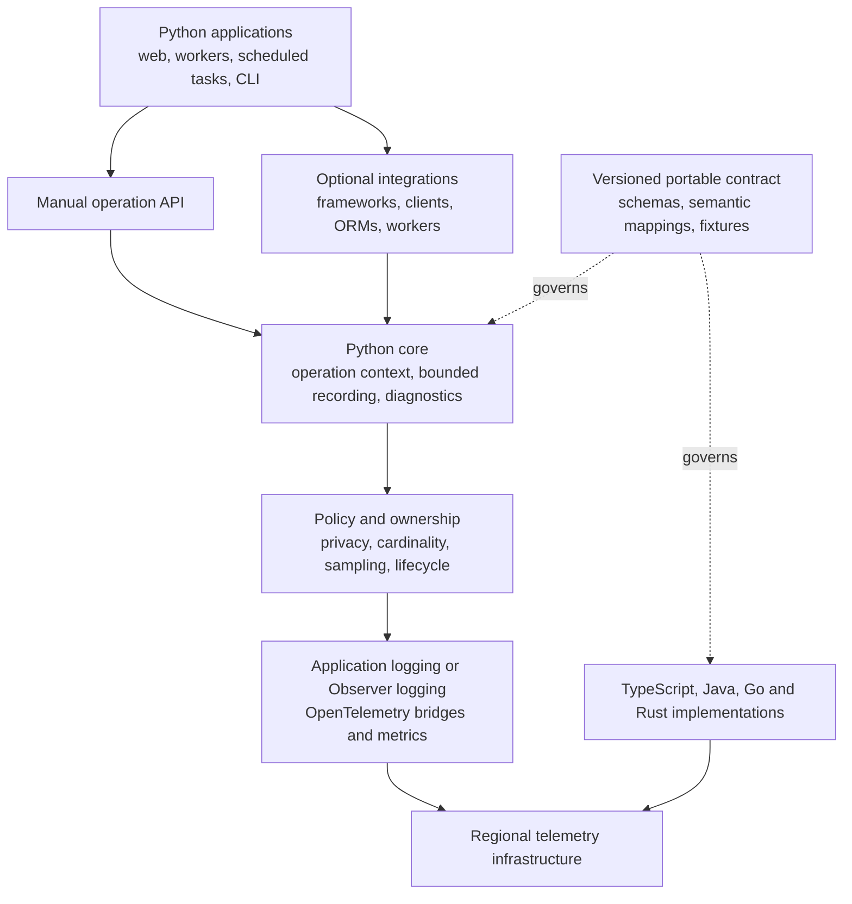

# Roadmap: Python observability and a portable ecosystem

**Reviewed:** 5 November 2026 · **Release:** 2.3.0 · **Compatibility baseline:** 2.2.1 · **Status:** proposed implementation roadmap

## Current delivery slice

The first delivery shipped as `2.3.0a1`: an opt-in Python operation experiment
in the existing distribution. Its scope is the
[2.2.1 compatibility baseline](https://github.com/Vitaee/FastapiObserver/blob/main/docs/baseline.md),
the bundled application-owned logging regression, a plain-Python SQLite/HTTP
proof and the experimental operation boundary. See the
[implementation plan](https://github.com/Vitaee/FastapiObserver/blob/v2.3.0/docs/plans/2026-11-04-experimental-core.md).

The second slice, released as `2.3.0a2`, shares completed-call recording across
native integrations and experimental custom callbacks. It captures ownership
at start, rejects late completion, bounds sampled-span tracking and records a
narrow [draft operation contract](https://github.com/Vitaee/FastapiObserver/blob/main/spec/README.md).
See its [implementation plan](https://github.com/Vitaee/FastapiObserver/blob/v2.3.0/docs/plans/2026-11-04-call-recording.md).
This advances the M1/M2 interfaces; it does not complete either milestone or
claim new datastore integrations or portable-contract 1.0.

The third slice, released as `2.3.0a3`, adds matched routes, separate native
SQL execution/failure detail, observation and sampling metadata, generated
redaction checks and an engine-scoped query-budget helper. See
[request diagnostics](https://github.com/Vitaee/FastapiObserver/blob/main/docs/request-diagnostics.md).
It preserves legacy count/metric meanings and keeps broad integrations and
language implementations outside this delivery.

The stable `2.3.0` release includes the preceding slices and adds ASGI
response-start/first-body/stream timing and bounded
N+1/pool events on existing recording server spans. It also removes redundant
log-sanitization work and corrects SQLite integration-test cleanup. These changes
retain request/count semantics and do not complete the generic lifecycle or
portable contract.

Stable distribution versioning preserves the existing FastAPI product's release
policy. The opt-in operation API and `0.1.0` schema remain experimental; the
broader generic product and portable contract still require their own gates.

Prior real FastAPI adoption is reported by the maintainer. The maintainer chose
the bundled application for this change's reproducible validation; independent
deployed-app validation is not claimed. The first slice does not require
Redis/MongoDB/Tortoise adopter examples, broad framework support or a language
pilot. Those remain prerequisites for their own milestones.

This experiment can ship before M3–M6. It keeps required framework dependencies,
the existing root API and FastAPI output. It proves imports and operation
behavior without frameworks; it does not claim an ordinary framework-free
installation, the full M2 lifecycle contract or a stable portable schema.
M7 continues to gate the later generic stable product and portable contract 1.0.

Build a Python-first observability library whose core works across frameworks,
database clients and execution models. Publish a language-neutral contract so
developers can build compatible TypeScript, Java, Go and Rust implementations.
FastAPI remains a supported integration throughout the migration.

This document distinguishes shipped behavior from proposed work. Milestone IDs
describe dependencies, not promised release dates. Package names, new public APIs
and support ranges become commitments only after the corresponding design and
compatibility checks. Shipped changes remain in the
[changelog](https://github.com/Vitaee/FastapiObserver/blob/main/CHANGELOG.md).

## What success means

1. A Python developer can observe a web request, background job, scheduled task,
   message handler or command without installing a particular web framework,
   ORM, database client or exporter.
2. A small manual API supports any application with a meaningful operation
   boundary. Automatic diagnostics are available through explicitly enabled,
   tested integrations with published capabilities.
3. Core counts and diagnostic decisions work when tracing is disabled or
   unsampled. Partial observations are identified as partial.
4. Applications retain control of logging, telemetry providers, signal handling,
   retries and resource ownership. Installation does not silently replace them.
5. Implementations in other languages can pass the same contract tests and feed
   shared backend queries, dashboards and alerts for their common capabilities.
6. Each release has evidence for privacy, resource bounds, failure behavior,
   compatibility and overhead. Stability is assessed per component and adapter.

Ecosystem coverage grows through a documented extension API. The support matrix
must name the integrations actually tested; installing an arbitrary Python
package does not automatically make its internal operations observable.

## Starting point

The 2.2.1 release is the production-hardening baseline. The package is still
classified Beta. This roadmap expands its product scope; it does not describe
capabilities already shipped under a new name.

Keep the current Python 3.11 minimum during extraction; the existing release
matrix covers Python 3.11–3.15. A runtime-floor change needs a separate
compatibility decision. Alternative interpreters and free-threaded builds need
their own validation before receiving a support claim.

| Area | Shipped in 2.2.1 | Work required for the broader scope |
|---|---|---|
| Installation | FastAPI installer and lifespan integration; FastAPI and Starlette are required dependencies | Separate framework-independent initialization, configuration and lifecycle |
| Public imports | Root exports import FastAPI setup and framework-related types | Make the core importable without framework packages or import-time side effects |
| Logging | Structured logging, correlation, bounded queues, custom sinks and application-owned logging | Make context and lifecycle independent of requests; document ownership for every output path |
| Context | A shared `RequestState` carries counts, held records and user context | Introduce generic operation state with nesting, concurrency and explicit background-work rules |
| HTTP diagnostics | Explicit HTTPX, HTTPX2 and Requests helpers count calls without tracing | Move their recorder to the generic core and retain deduplication with tracing |
| SQL diagnostics | SQLAlchemy engine events count successful queries without tracing; actual sync/async SQLite tracing tests | Add explicit failure and attempt semantics, generic datastore recording and more backend tests |
| Other datastores | Generic client-span fallback can contribute database totals | Add tested Redis, PyMongo and Tortoise integrations; identify sampled observations separately |
| Extension hooks | Explicit enrichers, filters, metric hooks and sinks; some hook types use Starlette objects | Add a framework-independent adapter interface while preserving existing hooks |
| Privacy | Field-name masking, URL-credential masking, bounded SQL fingerprints and safe logging failure summaries | Define policy across all Observer-managed signals; address trace payloads and custom extensions explicitly |
| Runtime safety | Disconnect, SIGTERM, blocked-sink, Collector-outage, memory, fork and recycling regressions | Extend the failure matrix to generic operations and every promoted integration |
| Publication | Immutable commit checks, one stored distribution, checksum verification and retry checks | Preserve the chain if packaging expands to multiple distributions or registries |
| Portability | Python implementation and Python-specific tests | Publish a specification, fixtures, executable conformance tooling and a second implementation |

Useful source boundaries are the
[public API](https://github.com/Vitaee/FastapiObserver/blob/v2.2.1/src/fastapiobserver/__init__.py),
[request state](https://github.com/Vitaee/FastapiObserver/blob/v2.2.1/src/fastapiobserver/request_context.py),
[plugins](https://github.com/Vitaee/FastapiObserver/blob/v2.2.1/src/fastapiobserver/plugins.py),
[SQL counting](https://github.com/Vitaee/FastapiObserver/blob/v2.2.1/src/fastapiobserver/db_queries.py),
[span fallback](https://github.com/Vitaee/FastapiObserver/blob/v2.2.1/src/fastapiobserver/otel/tracing.py)
and [shared validation](https://github.com/Vitaee/FastapiObserver/blob/v2.2.1/.github/workflows/validation.yml).

## Architecture direction

Use an incremental extraction. Keep the current FastAPI entry points usable
while moving reusable behavior behind a small core. Reuse established telemetry
implementations and require the same diagnostic contract from every adapter.

| Approach considered | Benefit | Cost | Direction |
|---|---|---|---|
| Extract a core and retain compatibility facades | Existing users can migrate gradually; current regression evidence remains useful | Temporary facade code and explicit ownership boundaries | Recommended |
| Rewrite the project around a new package immediately | Freedom to change every interface together | Large compatibility risk; production behavior must be re-established at once | Keep as a fallback only if extraction proves unworkable |
| Add more instrumentors directly to the current installer | Fast path to additional traced libraries | Retains framework dependencies and sampled-count limitations | Use existing instrumentors behind adapters where appropriate |

### Boundaries to preserve

- **Core:** operation state, correlation, bounded aggregation, diagnostic rules
  and a small lifecycle interface. Framework request objects and database client
  classes stay outside it. Prefer standard-library types in core interfaces.
- **Adapters:** translate public framework or driver hooks into core inputs.
  Each declares its supported versions, execution models and observable layers.
- **Telemetry bridges:** map to OpenTelemetry and existing logging/metrics APIs.
  Provider creation, borrowing, flushing and shutdown have explicit owners.
- **Policy:** applies to every output managed by Observer, including failure
  fallbacks. Application-owned pipelines have an explicit policy contract.
- **Specification:** defines interoperable behavior and serialized data. Python
  class layouts, thread models and framework objects are implementation details.

OpenTelemetry supplies existing signal models and protocol implementations.
Observer-specific conventions should describe the additional diagnostics and
their lifecycle. Map standard fields to the
[OpenTelemetry specification](https://opentelemetry.io/docs/specs/otel/) and
[log data model](https://opentelemetry.io/docs/specs/otel/logs/data-model/).
Use [W3C Trace Context](https://www.w3.org/TR/trace-context/) for distributed
trace propagation. A new transport protocol is outside this roadmap.

### Core interfaces to design in M1 and implement in M2

Keep the public surface small: initialization, an operation context manager,
correlation access, a completed-call recorder, explicit adapter attachment and
deadline-aware flush/shutdown. Provide synchronous and asynchronous operation
boundaries with equivalent outcomes. Final names and signatures belong in the
M1 API design and its examples.

The recorder consumes sanitized, typed metadata and a monotonic duration. It
must also accept explicit operation handles for callbacks that run outside the
originating context. Handles expire when an operation closes; late callbacks
cannot resurrect it or attach themselves to another request.

The adapter attachment result declares ownership and capabilities and provides
idempotent detachment. Prefer one recorder and one lifecycle contract over a
generic plugin framework, dependency-injection container or per-driver pipeline.

## Milestones and dependency order

Estimates below are initial engineering estimates for one experienced maintainer
working full time, including tests and documentation. They exclude waiting for
external adopters and upstream fixes. Re-estimate after M2; no calendar dates or
release numbers are promised.

| ID | Deliverable | Dependencies | Initial effort |
|---|---|---|---|
| M0 | Verified baseline, compatibility inventory and project scope | Released 2.2.1 | 1–2 weeks |
| M1 | Draft portable contract, API design and shared fixtures | M0 | 2–3 weeks |
| M2 | Framework-independent Python core behind the current API | M1 | 3–5 weeks |
| M3 | SQLAlchemy, Redis, MongoDB and Tortoise adapter coverage | M2 | 4–7 weeks |
| M4 | Generic Python operations and broader runtime integrations | M2; M3 for datastore scenarios | 3–5 weeks |
| M5 | Capacity, failure, privacy and deployment evidence | M2–M4 capabilities under test | 3–5 weeks |
| M6 | Porting toolkit and an independent language pilot | M1 and M2; can start before M3–M5 finish | 2–4 weeks |
| M7 | Stable contract and a generic Python release with migration support | M3–M6 and field validation | 2–3 weeks |
| M8 | Maintained implementations in the remaining target languages | M6 and M7 | Estimate separately; initially 4–8 weeks per language for the limited first scope |
| M9 | Continuous compatibility, security and ecosystem maintenance | Begins at M0; ongoing after release | Recurring capacity |

M0–M7 total roughly **20–34 maintainer-weeks** if executed sequentially. Field
validation adds elapsed time and can overlap development. M6 is intentionally
early enough to expose Python-specific assumptions before contract 1.0.
Each milestone ships in reviewable slices; this program is too broad for one
implementation PR.

## M0 — Verify the baseline and establish compatibility rules

**Outcome:** a truthful starting point and a migration contract existing users
can rely on.

- [x] Audit README, architecture, database and deployment claims against 2.2.1.
  Correct references that still call it unreleased, describe raw SQL in N+1
  warnings, or imply native SQL counting requires tracing.
- [x] Record public exports, documented submodule APIs, `OBS_*` settings,
  supported `OTEL_*` settings, event shapes, metric names, label sets and timing
  semantics. Capture representative output as compatibility fixtures.
- [x] Classify current global state: process-owned logging, borrowed providers,
  per-application registrations, engine registries and per-operation data.
- [x] Inventory import dependencies and side effects, including root exports,
  settings, metric hooks, endpoint mounting and OTel lifecycle wrappers.
- [x] Publish a claim-to-evidence matrix with links to tests and known limits.
  Keep Beta until the relevant stability gates pass.
- [ ] Confirm licensing and contribution rules for schemas, fixtures, generated
  artifacts and future implementations. Propose neutral project/package naming;
  check registry availability and import conflicts before reserving names.
- [ ] Obtain representative integration examples: an existing FastAPI service,
  a Redis/MongoDB application, a Tortoise application and a worker or CLI tool.
  Sanitized reproducible examples are sufficient to begin design.

The checked baseline work is recorded in [the compatibility inventory](https://vitaee.github.io/FastapiObserver/baseline/).
M0 remains open for portable-artifact contribution/naming policies and the broader
adopter examples. The bundled FastAPI app is validated; external applications
and the unimplemented datastore adapters are not claimed as validated.

**Exit gate:** the compatibility inventory is committed; existing release gates
remain green; every current support claim has evidence or a visible limitation.
Record proposed changes to accepted architecture decisions in new decision
records rather than rewriting historical records.

## M1 — Define the portable contract

**Outcome:** another developer can implement the core behavior without reading
Python internals.

- [ ] Create `spec/` containing normative requirements, version policy, semantic
  mappings and examples, plus JSON Schemas for the JSON representation. Define
  required and optional capability profiles.
- [ ] Design the small Python API against web, worker and command examples.
  Keep extension callbacks independent of FastAPI and Starlette types.
- [ ] Define generic operation outcomes and the mapping from existing
  `request.*` events. Preserve the 2.x output contract through a compatibility
  representation until users explicitly migrate.
- [ ] Define count ownership, deduplication and completion rules before adding
  more driver hooks. Include errors, cancellation, retries, nested operations,
  callbacks and work that outlives a response.
- [ ] Pin the semantic-convention versions each bridge emits. Define how older
  attribute names map to the selected version and how opt-in migrations work.
- [ ] Add deterministic fixtures with valid and invalid records, propagation
  carriers, timing cases, redaction vectors, count expectations and resource
  limits. Reserve an extension namespace for application-defined fields.

### Contract topics and required decisions

| Topic | Contract requirement |
|---|---|
| Identity | Define service, deployment, SDK, integration and schema identities; specify trace/span ID formats and optional local operation IDs |
| Operations | Define start/end, parent and linked work, exactly one local terminal outcome, idempotent close and context restoration |
| Timing | Use monotonic clocks for elapsed time; UTC wall time for timestamps; distinguish response time, operation lifetime and summed dependency time |
| Serialization | Define units, timestamp precision, missing versus null, Unicode, finite numbers, byte/array/depth limits and integers beyond JavaScript's safe range |
| Outcomes | Separate success, failure, cancellation and observed disconnect; include a cause only when evidence exists |
| Dependency calls | Identify datastore/system, adapter and observation layer; distinguish logical calls, driver attempts, retries and batches |
| Completeness | Expose whether counts come from native hooks, sampled spans or manual recording; identify unsupported and unknown fields explicitly |
| Aggregation | Bound per-operation fingerprints and system groups; track overflow; retain complete supported totals when detail is capped |
| Metrics | Define instrument names, types, units, bucket boundaries and bounded attributes; version incompatible changes |
| Diagnostics | Define stable warning codes, severity, supporting measurements, thresholds and remediation links; distinguish observation from inferred cause |
| Privacy | Set defaults for secrets, query/document capture, exception text, custom context and every signal/output path |
| Propagation | Validate incoming headers; distinguish trace context from authenticated identity; define trust boundaries and allowlisted baggage |
| Configuration | Define common setting names, types, defaults, validation and precedence; retain standard `OTEL_*` semantics and isolate runtime-specific options |
| Lifecycle | Define repeated initialization, borrowed providers, multiple applications, shutdown deadlines and behavior after closure |
| Delivery | Describe admission, sampling, overflow, export failure and shutdown loss separately; document retry duplication possibilities |
| Capabilities | Make unavailable runtime/pool signals distinguishable from a measured zero; publish conformance by profile |

Overlapping async calls may sum to more than the operation's wall duration.
That value measures accumulated call time; it cannot identify the critical path
by itself. Parent summaries must also define whether they include child calls,
so nesting does not accidentally double-count service metrics.

Observer-specific fields and standard telemetry mappings have separate version
policies. A change to an upstream experimental convention must not silently
change an existing Observer schema. OpenTelemetry documents
[different maturity levels across language SDKs and signals](https://opentelemetry.io/docs/languages/),
and its [event conventions](https://opentelemetry.io/docs/specs/semconv/general/events/)
are currently in development. Pin tested behavior and publish the dependency
status instead of promising uniform upstream maturity.

**Exit gate:** schemas validate all fixtures; invalid examples fail with useful
errors; manual API examples cover web, worker and CLI boundaries; a porting
review finds no Python-only requirement in the mandatory profile.

## M2 — Extract the Python core and preserve FastAPI behavior

**Outcome:** reusable Python behavior is separated from framework wiring.

- [x] Introduce internal `core/` boundaries for operation context and completed-call
  recording, shared by native integrations and the opt-in operation boundary.
- [ ] Separate reusable lifecycle coordination from framework wiring. Existing
  logging/provider ownership is inventoried and preserved; no generic runtime
  lifecycle API has been shipped.
- [x] Keep route discovery, ASGI messages, HTTP response timing, endpoint mounting,
  trusted proxy handling and framework exceptions in the appropriate adapter.
- [x] Preserve existing root exports and documented hooks through facades.
  Remove eager framework imports from the core's import path without changing
  what existing FastAPI installations receive.
- [x] Support sync and async context managers, explicit context handoff to thread
  pools, nested operations, detached work and exception-safe restoration. A
  closed operation releases held records and detailed aggregation state.
- [x] Move SQL/HTTP totals onto the common recorder. Keep exact legacy event
  mappings and existing SQLAlchemy/HTTP span deduplication during extraction.
- [ ] Define lifecycle ownership per resource. Detaching one application must
  not stop another application's logging or a borrowed global provider.
  Observer-created resources have explicit final shutdown; borrowed resources
  follow their owner's policy.
- [ ] Bound state for long-lived operations, including HTTP span-ID deduplication,
  held records, exception summaries and callbacks. A bounded record count alone
  is insufficient when individual record size is unbounded.
- [x] Preserve process fork/reset behavior and explicit registration. Importing
  the core starts no listener, watcher, network exporter or driver instrumentation.

M2 is partial: request/call ownership, operation nesting/restoration, import
separation and existing FastAPI compatibility have executable evidence. Generic
resource lifecycle and byte bounds for arbitrary held log payloads remain open.
The operation schema is experimental `0.1.0`, not portable contract 1.0.

**Packaging during extraction:** keep the 2.x distribution's current framework
dependencies. Test core imports and operation behavior in a clean environment
without those dependencies, using an isolated installation that deliberately
omits dependency installation. This proves internal separation; the normal
framework-free installation becomes a public guarantee at M7.

**Exit gate:** core import and manual-operation tests pass without FastAPI,
Starlette, SQLAlchemy, Redis, PyMongo or OpenTelemetry installed. Existing wheel,
compatibility and production gates pass through the FastAPI facade. Use manual
CPU comparisons for performance-sensitive changes.
Closing one operation or application cannot corrupt a concurrent one.

## M3 — Provide datastore coverage beyond SQLAlchemy

**Outcome:** SQLAlchemy, Redis, MongoDB and Tortoise users receive honest,
comparable diagnostics through optional adapters.

Build the shared recording and capability rules once. Implement each integration
against supported public hooks where possible. A hook available only on recording
spans cannot supply tracing-independent counts; use a suitable driver hook or
wrapper, or declare that capability unavailable. Isolate any necessary private
API and version-bound it with compatibility tests.

### Common adapter requirements

- [ ] Attach to explicit clients/engines or an explicitly selected global
  instrumentor. Repeated installation is idempotent; detachment removes only
  Observer-owned hooks. State the required client creation order.
- [ ] Record success, failure, cancellation and duration at the declared
  observation layer, including callback failures and operations outside HTTP.
- [ ] Keep sampling-independent counts separate from sampled-span observations.
  Tracing at ratios 0, 0.1 and 1 must not change native counts.
- [ ] Publish a decision table for ORM plus driver plus OTel combinations.
  One layer owns each aggregate; spans from other layers may still be useful.
- [ ] Bound datastore identifiers and operation categories. Use configured
  aliases for clients; do not derive metric labels from keys, documents,
  statements, user IDs, raw URLs or unbounded collection names.
- [ ] Export command/query contents only under explicit policy. A hash of
  sensitive input can still disclose information through guessing; a fingerprint
  is neither anonymization nor a metric label.
- [ ] Verify multiple clients, shared pools, repeated attachment, teardown,
  credentials, timeouts, retry behavior and unavailable servers with real services.

### Integration-specific deliverables

| Integration | First implementation scope | Required edge cases and honest limits |
|---|---|---|
| SQLAlchemy | Preserve sync/async engine counting and existing tracing; add failed-query semantics through the common recorder | Multiple engines, transactions, executemany, pool exhaustion, cancelled async calls and ORM/driver/OTel deduplication |
| Redis | Test `redis-py` sync and asyncio clients with explicit client aliases | Pipelines, transactions, blocking commands, timeout, cancellation and reconnect; distinguish a pipeline execution from commands within it |
| MongoDB | Test PyMongo synchronous and asynchronous clients separately using supported monitoring facilities where suitable | Lazy cursor execution, `getMore`, bulk commands, sessions, retryable operations, callback context and pool events |
| Tortoise ORM | Add direct Tortoise integration and reuse the SQL datastore contract; test SQLite and PostgreSQL first | Lazy query evaluation, transactions, multiple connections, prefetch behavior, cancellation and Tortoise/driver/OTel deduplication |

Keep legacy SQL successful-query totals unchanged while exposing failure and
attempt counts through explicit fields in the generic representation. Freeze
each adapter's fingerprint algorithm and version in the contract fixtures;
changing normalization must not silently change diagnostic grouping.

Redis Cluster/Sentinel, Redis Pub/Sub/Streams, MongoDB change streams and
Tortoise MySQL support each need their own lifecycle and real-service scenarios.
They remain experimental or unclaimed until those tests exist. A long-lived
subscription is not an ordinary short command. MongoDB transaction/failover
claims require a replica-set test topology, not only a standalone container.

For new MongoDB work, prioritize PyMongo Async. MongoDB provides an official
[migration path from Motor](https://www.mongodb.com/docs/languages/python/pymongo-driver/current/reference/migration/).
Any Motor compatibility layer needs an explicit user need, version range and
retirement policy; shared implementation details do not establish support.

Existing official OpenTelemetry instrumentors for
[Redis](https://opentelemetry-python-contrib.readthedocs.io/en/latest/instrumentation/redis/redis.html),
[PyMongo](https://opentelemetry-python-contrib.readthedocs.io/en/latest/instrumentation/pymongo/pymongo.html)
and [Tortoise](https://opentelemetry-python-contrib.readthedocs.io/en/latest/instrumentation/tortoiseorm/tortoiseorm.html)
are candidates for tracing bridges. Their presence does not certify Observer's
native counts, privacy policy or exact async-driver combinations. Follow the
chosen [database semantic conventions](https://opentelemetry.io/docs/specs/semconv/db/database-spans/)
for the standard span fields.

**Exit gate:** one request and one non-HTTP operation can use SQL, Redis and
MongoDB together, yielding separate per-system summaries with exact expected
counts at each supported layer. Test tracing off/on, sampled/unsampled, errors,
cancellation, secret-bearing inputs and instrumentation overlap. Publish
unsupported capabilities alongside supported ones.

## M4 — Expand across Python execution models

**Outcome:** developers outside FastAPI can adopt the same core, with a manual
path available even when their framework has no maintained adapter.

- [ ] Ship runnable manual examples for sync/async functions, CLI commands,
  scheduled tasks and message handlers. Include logging-only operation and
  operation without any exporter or web framework.
- [ ] Make the FastAPI integration a consumer of the core. Preserve response
  versus application timing, trusted correlation, disconnect observation,
  streaming, background failures and existing logging ownership options.
- [ ] Provide a generic ASGI integration with explicit route-template resolvers.
  Start with Starlette; validate additional ASGI frameworks individually.
- [ ] Add a WSGI integration, initially exercised with Flask. Include streaming
  iterable closure, exceptions after headers, concurrent threads and cleanup.
- [ ] Add Django-specific route and lifecycle integration with separate WSGI
  and ASGI tests before claiming both execution models.
- [ ] Validate one worker integration against a real user workload. Celery is
  a candidate, not a prerequisite for the core. Distinguish message identity,
  execution attempt, retries, fan-out and linked work; keep scheduling,
  acknowledgement and retry decisions with the worker framework.
- [ ] Publish an adapter-author tutorial using a small example client and the
  contract fixtures; connect it to the executable conformance runner in M6.
  Include installation, ownership, safe metadata capture, teardown, tests,
  version ranges and a complete capability manifest.

The earlier roadmap deferred worker diagnostics until demonstrated demand.
The broader scope now requires a generic non-HTTP operation boundary. Automatic
Celery, RQ, Dramatiq, ARQ and scheduler integrations still need individual user
evidence and maintainers; they need not all ship in the first generic release.

**Exit gate:** the same contract scenarios pass through manual operations,
FastAPI, generic ASGI, Flask/WSGI and the promoted Django modes. A worker pilot
demonstrates useful diagnostics beyond adding context fields to a logger.
Unsupported frameworks can use the manual API without depending on a web stack.

## M5 — Establish production and global-deployment evidence

**Outcome:** measured resource costs and documented behavior under realistic
failure and deployment conditions.

Production checks apply from the first core change onward. M5 expands and
consolidates the evidence; it is not a reason to defer safety until later.

### Retain the existing gates

The following are current regression budgets in the controlled test workload,
not service-level guarantees for arbitrary applications:

| Behavior | Existing 2.2.1 gate |
|---|---|
| Graceful server drain | Eight concurrent requests finish with one terminal record each; process exits in less than 4 seconds |
| Collector outage | Ten local requests finish in less than 2 seconds; local completion records remain; shutdown is less than 4 seconds with the test export timeout |
| Warm-worker memory | After 300 warm-up requests and 1,000 additional requests: heap growth below 8 MiB, Linux RSS growth below 32 MiB, thread growth at most 2 |
| Blocked logging sink | Across 100 loopback requests, p95 below 100 ms and dropped records counted |
| Queue lifecycle | Flush/stop waits are bounded; live resources survive a stop timeout so the caller can retry |
| Backend delivery | Existing Compose verifier passes with traces enabled and disabled, using the built wheel |
| Worker lifecycle | Fork safety and recycled-worker request/histogram totals are exercised |

CPU comparisons remain manual diagnostics. The existing command compares nine
alternating baseline/candidate pairs for default and application-owned logging,
using `0.10 * median(baseline) +
3 * 1.4826 * MAD(paired_differences) / sqrt(pair_count)` as a review threshold.
An unreliable run is inconclusive; preserve the samples and investigate on a
quiet machine. Shared-runner CPU variance does not block CI or release publication.

### Extend the acceptance matrix

- [ ] Run each adapter with tracing disabled, ratios 0/0.1/1, a borrowed provider,
  library-owned logging and application-owned logging where applicable.
- [ ] Add thread-pool saturation, combined thread/pool pressure, load-balancer
  timeout and deployment interruption to the failure lab. Attribute a cause
  only from explicit server/adapter evidence; cancellation alone is insufficient.
- [ ] Add 30-minute CI soaks and a release-candidate soak of at least 24 hours
  for promoted core/runtime profiles. Measure retained heap/RSS, thread/handle
  counts, queue depth, cardinality and resource growth after warm-up.
- [ ] Test small, large and malformed records, many unique paths/statements,
  long-lived operations and slow consumers. Define byte limits as well as
  item counts. Assert zero retained closed-operation entries after cleanup.
- [ ] Model budgets per process: maximum active operation state, held-record
  bytes, queue bytes, exporter buffers and metric series. Report measured
  capacity at a stated concurrency, workload and configuration.
- [ ] Extend paired benchmarks with core-only, HTTP, mixed-datastore and worker
  workloads. Separate source-code changes under identical dependencies from
  dependency-upgrade experiments; preserve both environments' manifests.
- [ ] Measure enabled versus disabled overhead as well as candidate versus
  baseline. Before promoting a new adapter, collect at least 20 paired samples
  on controlled hardware and publish its supported workload budget.
- [ ] Use a provisional p95 latency regression budget of 10% plus measured
  paired-run noise for an unchanged workload. Establish each adapter's absolute
  CPU/allocation budget from those measurements in a reviewed budget file;
  a consistent regression blocks release and cannot justify its own new limit.
- [ ] Verify Linux multiworker/container behavior and core behavior on macOS
  and Windows. Claim POSIX signal/fork behavior only on supported POSIX setups.
- [ ] Test TLS/authentication failures, DNS failure, slow Collector responses,
  reconnect, proxy settings and bounded exporter retries using nonsecret test
  credentials. Validate configuration changes without printing credentials.

### Delivery and shutdown contract

For an unloaded local sink with sampling disabled and a successful graceful
drain, require zero missing terminal records in the controlled test. This is a
local emission assertion, not exactly-once delivery to a remote backend.

Under overload, intentional sampling, exporter outage or process termination,
publish separate counts for records sampled out, rejected at admission, evicted,
export-failed or pending at deadline wherever the owning SDK exposes them.
If an upstream SDK cannot report a loss category, mark that visibility unknown.
OTLP retries can duplicate telemetry; force-kill can lose buffered data.

Use one overall shutdown deadline with remaining time passed to each owned
component. Server drain precedes the telemetry flush allowance. Borrowed
providers, blocking application handlers and arbitrary custom sink threads
follow their owner's constraints; a process supervisor supplies the final
termination bound. Telemetry must not install competing signal handlers.

### Global deployment model

Keep SDK state local to each process and independent of cross-region
coordination. Use regional Collectors and established backends for buffering,
routing, retention and storage. Export local resource identity such as service,
version, environment and region with a published cardinality budget.

- [ ] Provide regional deployment examples with bounded queues, backpressure,
  Collector sizing, TLS, secret injection and a capacity worksheet.
- [ ] Define field allowlists, retention guidance, residency restrictions and
  baggage policy. Cross-region failover is an explicit deployment policy.
- [ ] Run a region-isolation exercise: blocked telemetry export in one region
  must not block application operations or create unbounded SDK memory there.
- [ ] Publish per-process capacity and telemetry volume at 1x, 2x and 4x load,
  plus a multi-service scale run at a stated deployment size. Identify the
  first saturation point and actual drop/recovery behavior.
- [ ] Provide versioned dashboards and alert examples for SDK queue pressure,
  export failure, resource growth and regional ingestion gaps.

Default policy should minimize collected data before export. Review traces as
well as logs: OpenTelemetry's
[sensitive-data guidance](https://opentelemetry.io/docs/security/handling-sensitive-data/)
explains the need for data minimization and the limitations of hashing.

**Exit gate:** all promoted capabilities have checked-in budgets, reproducible
failure scenarios and capacity reports. At least three independent adopter
workloads complete a minimum 30-day canary period collectively covering
existing FastAPI logging/providers, Redis/MongoDB, Tortoise and non-HTTP work.
Record unresolved incidents and support limits before changing stability labels.

## M6 — Prove portability with tooling and a second implementation

**Outcome:** the portable contract is implementable outside Python.

- [ ] Publish the specification with a license suitable for implementation,
  generated documentation, positive/negative fixtures and a versioned release.
- [ ] Implement a conformance runner that accepts language-neutral inputs and
  validates structured output plus lifecycle, privacy and propagation behavior.
  A JSON Schema validator alone cannot verify concurrency or resource bounds.
- [ ] Provide test scenarios for exceptions, cancellation, nested operations,
  concurrent work, threads/tasks, late callbacks, unknown schema fields,
  borrowed providers, queue overflow and shutdown deadlines.
- [ ] Provide mapping tables from contract fields to JSON logs, OTLP records,
  spans and metrics. Validate IDs and relationships; normalize nondeterministic
  timestamps/IDs instead of requiring identical runtime-generated values.
- [ ] Write a porting guide covering context storage, logging bridges, clocks,
  numeric precision, lifecycle, packaging, adapter ownership and test execution.
- [ ] Build a TypeScript/Node.js pilot as the default proposal for the second
  implementation, unless a committed maintainer has a better real workload in
  another target language. Include manual operations and one HTTP integration.
- [ ] Run a Python-to-second-language-to-Python request chain through a real
  Collector. Assert trace linkage, correlation, outcome semantics, policy and
  common backend queries. Repeat with traces disabled for native diagnostics.
- [ ] Feed portability findings back into the draft before freezing 1.0.

**Exit gate:** Python and an independently implemented pilot pass the mandatory
profile and the same mixed-service demonstration. Document capability gaps and
upstream experimental APIs. The pilot is not advertised as a stable SDK.

## M7 — Release the generic Python product safely

**Outcome:** a clean framework-free installation, a stable portable contract and
a supported migration path for existing users.

- [ ] Finalize neutral distribution/import names after availability and
  ownership checks. Publish a generic core distribution; keep FastAPI-specific
  convenience dependencies in the FastAPI compatibility distribution.
- [ ] Start with optional integration extras or a focused integration module
  set. Split an adapter into its own distribution only for incompatible
  dependencies, an independent release cadence or separate ownership.
- [ ] Verify an ordinary core-only installation in a fresh environment does
  not install or import FastAPI, Starlette, a database driver or an exporter.
  The existing `fastapi-observer` facade installs its needed framework adapter.
- [ ] Ship prereleases with migration examples for FastAPI-only users,
  application-owned logging, existing OTel providers, mixed datastores and
  workers. Prevent side-by-side packages from installing duplicate pipelines.
- [ ] Version Python API, portable schema, semantic mappings and conformance
  tooling explicitly. Publish a compatibility table between their releases.
- [ ] Treat incompatible Python APIs, output field removals, configuration
  changes and metric semantic changes as major migrations. Keep a documented
  deprecation window of at least two feature releases and six months where
  practical; security changes may require an explicitly documented exception.
- [ ] Give the existing 2.x line a published security/support end date and
  migration window. A proposed minimum is 12 months after the generic stable
  release, contingent on a maintainer committing that capacity.
- [ ] Extend release identity checks to an artifact manifest listing every
  distribution, version, dependency relation, checksum and source SHA. Build
  each package once; tests, attestations and publication consume those bytes.
- [ ] Include dependency/license inventories and provenance; test conflicting
  retries, partial publication, compatibility constraints and package rollback.
  Publish new corrective versions instead of rewriting existing tags or files.
- [ ] Mark only validated components stable. Promoting the core does not
  automatically promote every experimental adapter or language implementation.

**Exit gate:** contract 1.0 is validated by two implementations; ordinary
framework-free install and migration rehearsals pass; M5 field reports and
release evidence are published; security contact and named maintainers exist.

## M8 — Build maintained language implementations

**Outcome:** developers can adopt compatible SDKs with native language ergonomics.

After the pilot, choose the next implementation according to a committed
maintainer and adopter workload. An initial preference is to stabilize Node.js,
then add Java and Go, and then Rust. This order is a proposal; it does not block
a qualified contributor from bringing another conforming implementation first.

| Ecosystem | Native concerns to address | Initial integration scope |
|---|---|---|
| TypeScript / Node.js | Async context across promises/callbacks, worker threads, log bridges, integer precision and process signals | Manual operations, Node HTTP and one selected framework; browser/edge runtimes need separate profiles |
| Java | Thread/executor context, virtual/reactive execution where supported, logging bridges and shared SDK ownership | Manual operations and one Servlet or Spring integration |
| Go | Explicit context propagation, goroutine lifetime, cancellation, bounded exporters and shutdown deadlines | Manual operations and `net/http` middleware |
| Rust | Ownership of context across futures, task cancellation/drop, `tracing` interoperability and runtime-specific shutdown | Manual operations and one selected Tokio HTTP integration |

For each language:

- [ ] Add a named maintainer, package ownership/recovery plan, supported runtime
  range and registry release process.
- [ ] Reuse the local OpenTelemetry implementation and logging conventions.
  Declare per-signal maturity; allow structured-log capability without requiring
  a globally installed OTel logs provider.
- [ ] Pass the mandatory contract profile and declared optional profiles.
  Runtime-specific diagnostics, such as event-loop blocking or JVM pressure,
  are optional capabilities with their own tests.
- [ ] Run cross-language HTTP and message propagation scenarios, backend query
  fixtures, privacy vectors, concurrency tests and native overhead measurements.
- [ ] Add database integrations incrementally, following the same count-layer,
  completeness and privacy rules used in Python. SQLAlchemy or Tortoise APIs do
  not need language equivalents for the common datastore profile to work.
- [ ] Publish examples, migration notes, version mappings, signed provenance
  where supported and a support policy before declaring the implementation stable.

**Exit gate per language:** conformance, real backend delivery, production budgets
and at least one adopter canary pass. Schema compatibility does not require
identical implementation code or identical runtime diagnostic capabilities.

## M9 — Maintain the ecosystem

- [ ] Assign owners to the core, specification, adapters and language packages.
  Keep stable, experimental, community-maintained and retired status visible.
- [ ] Publish a support matrix with tested Python/runtime, framework, driver,
  OTel and backend versions. Exercise oldest supported and current compatible
  dependencies; run upstream prerelease compatibility checks separately.
- [ ] Run fast contract tests on each PR, relevant real-service tests for touched
  integrations and the complete promoted-capability matrix before release.
- [ ] Track release regressions, benchmark variance, time to triage, migration
  failures, adapter usage, open compatibility issues and maintainership capacity.
- [ ] Maintain private security reporting, dependency audits, release provenance
  verification, credential rotation and registry account recovery procedures.
- [ ] Retire unmaintained integrations through the published deprecation policy;
  do not leave unsupported code carrying a stable badge.
- [ ] Review scope quarterly using adopter incidents and maintenance cost. Add
  libraries when public hooks, user need, tests and ownership are available.

## Target support matrix

This is a planning matrix, not an announcement of current support. Every future
entry requires tested version ranges and a capability report before promotion.

| Capability | Current state | Planned promotion path |
|---|---|---|
| FastAPI request diagnostics | Shipped | Preserve through M2; promote after M5/M7 evidence |
| Standalone structured logging | Shipped | Retain and document generic lifecycle in M2 |
| Manual sync/async operations | Experimental since 2.3.0a1 | Complete M2 lifecycle/bounds; broader adoption in M4 |
| SQLAlchemy native counts | Shipped for configured engines; common recorder since 2.3.0a2 | Broader backend evidence in M3 |
| HTTPX/HTTPX2/Requests native diagnostics | Shipped through explicit helpers, including experimental operations | Broader runtime evidence in M4 |
| Redis sync/async diagnostics | Sampled-span fallback only | Dedicated capability-tested adapter in M3 |
| PyMongo sync/async diagnostics | No dedicated tested adapter | Separate driver-mode validation in M3 |
| Tortoise diagnostics | No dedicated tested adapter | SQLite/PostgreSQL in M3; MySQL separately |
| Generic ASGI / Starlette | No standalone support claim | Adapter and server tests in M4 |
| Flask / WSGI | Planned | M4, including streaming and threads |
| Django | Planned | Promote WSGI/ASGI modes independently in M4 |
| Worker framework adapters | Deferred pending workload evidence | Generic boundary in M2; one validated framework pilot in M4 |
| Other Python libraries | Existing logging/custom hooks; no universal automatic diagnostics | Manual API and documented adapter contract |
| Other language SDKs | Planned | Independent pilot in M6; maintained implementations in M8 |

## Packaging, compatibility and implementation sequence

Keep the current repository while extracting the Python core and publishing the
specification. Suggested additions are `spec/`, `conformance/`, focused internal
`core/` modules and explicit `integrations/` modules. The published generic
import name is decided at M7. Keep package splitting proportional to actual
dependency and release needs.

Proposed reviewable implementation slices:

| Slice | Deliverable | Main proof |
|---|---|---|
| 1 | Current claims, compatibility fixtures and ownership inventory | Fixtures match released 2.2.1 behavior |
| 2 | Draft schema, metric mappings and positive/negative vectors | Schema validation and documented outcomes |
| 3 | Core context and manual sync/async operation boundaries | Nesting, exceptions, concurrent tasks/threads and cleanup |
| 4 | Common call recorder and capability manifests | Count layers, bounded detail, errors, late callbacks and overflow |
| 5 | FastAPI facade plus generic lifecycle and logging ownership | Existing wheel/runtime gates and two applications sharing resources |
| 6 | SQLAlchemy and HTTP helpers on the recorder | Legacy output parity and zero native/span double-counting |
| 7 | Redis adapter | Real sync/async, pipeline, timeout and privacy scenarios |
| 8 | PyMongo adapter | Separate sync/async, cursor, retry, pool and callback-context scenarios |
| 9 | Tortoise adapter | SQLite/PostgreSQL, lazy execution, cancellation and driver overlap |
| 10 | Generic ASGI then WSGI integration | Route cardinality, streaming, disconnect and iterable cleanup |
| 11 | Django integration and worker pilot | Mode-specific server tests and validated job semantics |
| 12 | Conformance runner and second-language pilot | Shared fixtures plus cross-language backend demonstration |
| 13 | Capacity/soak lab and operational assets | Published budgets, failure reports and regional isolation |
| 14 | Generic packaging, migration and publication manifest | Clean install, prerelease upgrade and artifact-identity rehearsal |
| 15 | Stable release and component support policies | Field canaries, compatibility matrix and complete release evidence |

Each slice includes the relevant tests and documentation. Slice 12 can begin
after slices 3–5 while datastore coverage grows. Capacity tests run throughout;
slice 13 completes the release evidence. Detailed implementation plans should
pin file paths, APIs and assertions for the next slice only, using what prior
slices proved.

## Risks and decision gates

| Risk | Required response |
|---|---|
| Building a second telemetry SDK | Reuse upstream protocol/exporter implementations; add only the required diagnostic contract and bridges |
| Claiming every library works automatically | Separate manual support from tested adapter capabilities and unsupported behavior |
| Counting the same operation twice | Declare the observing layer and owner; test ORM/driver/OTel combinations |
| Treating retries or cursor batches as user queries | Publish logical/physical/batch semantics; report unavailable layers as unknown |
| Treating repeated cache commands as N+1 SQL | Use datastore-specific rules; test legitimate batching, prefetch and cache workloads for false positives |
| Sensitive data escaping through spans or fallbacks | Apply explicit policy to all managed signals and failure paths; keep borrowed-pipeline limits visible |
| Cardinality and long-lived state growth | Bound bytes, categories, fingerprints, deduplication and retained handles; measure saturation |
| Global state breaking multiple applications | Explicit ownership and idempotent attachment; one application's stop cannot stop another's resources |
| Porting Python implementation assumptions | Validate the draft with a second implementation before contract 1.0 |
| Upstream signal maturity or private APIs changing | Pin tested versions, isolate unstable APIs and run compatibility checks |
| Expanding beyond maintenance capacity | Require owners and adopter evidence per integration; publish limited support rather than broad claims |
| Package/schema migrations breaking dashboards | Version telemetry separately, ship mapping fixtures and rehearse mixed-version deployments |

## Work outside the initial scope

A hosted telemetry database, custom Collector, proprietary transport,
observability UI product, business audit-log system and general health/readiness
framework would require separate justification and ownership. Existing
Collector/backend integrations and operational examples serve this roadmap.

Automatic source translation between languages is also outside the portability
goal. Developers implement the same contract with native APIs and runtime
behavior. Browser telemetry, profiling, every Python framework and every
datastore topology can follow separate capability proposals once the shared
foundation and maintenance capacity exist.

The existing FastAPI runtime controls remain supported according to their
current scope. A cross-language remote control plane is a separate project and
must not become a dependency of local diagnostics.

## Next work

Keep the shipped FastAPI behavior and the experimental operation boundary covered
by the existing compatibility, wheel, backend and production budgets. Finish the
remaining M0 policy/evidence items and M2 lifecycle/byte-bound decisions before
claiming those milestones complete. The broader M1 contract, datastore adapters,
framework integrations and language pilot remain separately gated work.
