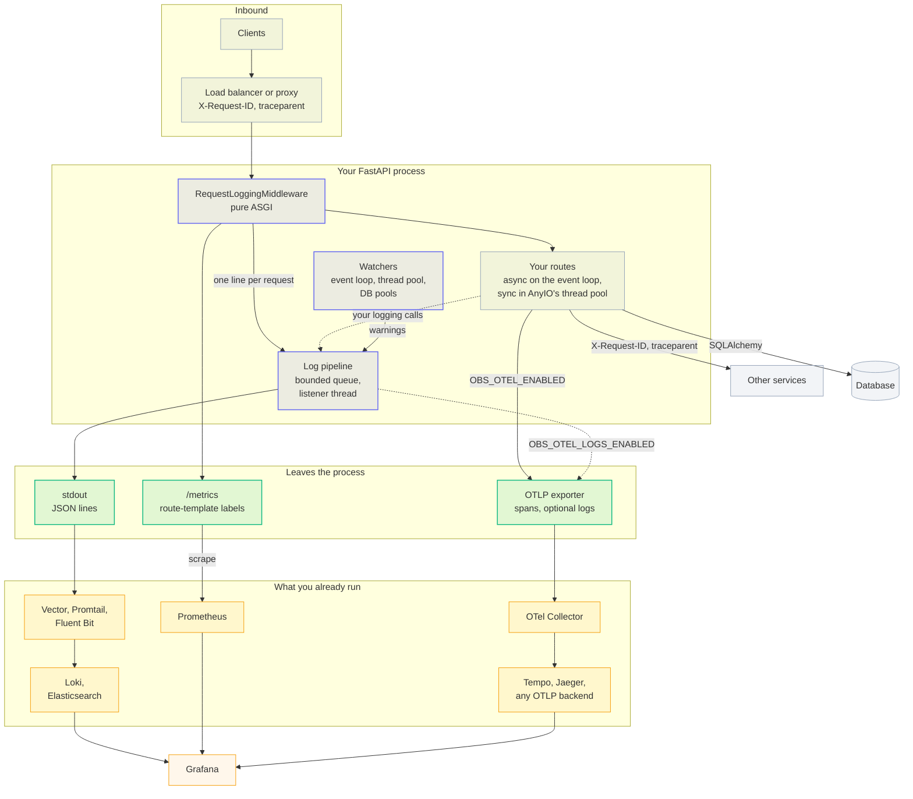
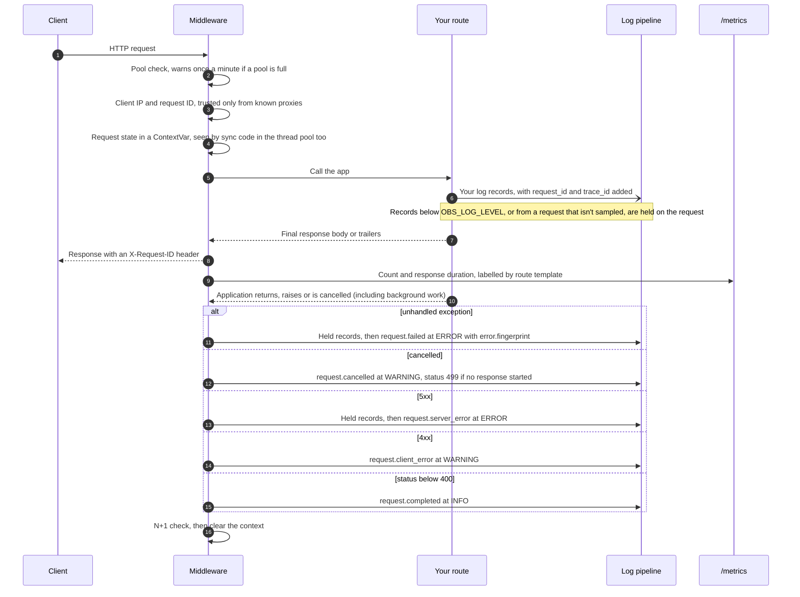
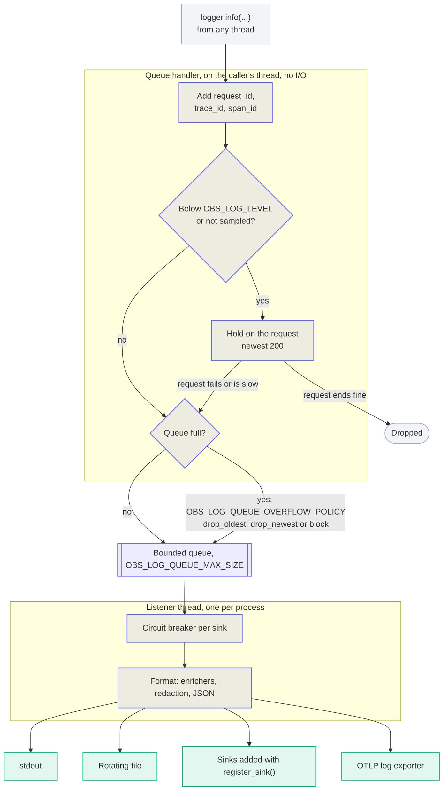
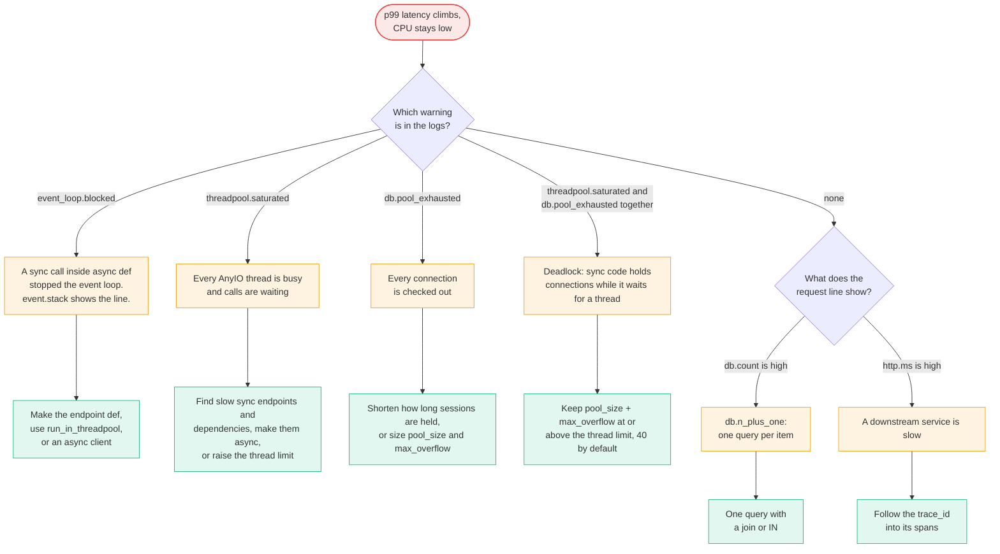

# Architecture

Why it's built this way, with the evidence and what each choice cost, is in the [design decisions](decisions/index.md).

## The system at a glance

Everything runs inside your FastAPI process. There is no agent and no vendor backend: data leaves as JSON lines on stdout, as a Prometheus `/metrics` page, and over OTLP.

Purple is fastapi-observer, green is where data leaves the process, and orange is what you run already. The optional runtime control endpoint is left out.

These diagrams show the default library-owned logging pipeline. With
`configure_logging=False`, diagnostics use the application's existing handlers,
sanitizer, formatting, export and shutdown. The library adds no logging queue or
log exporter in that mode. See [application-owned logging](logging.md#application-owned-logging).

## What `install_observability()` Wires Up

1. Profile-aware config bootstrap (`OBS_PROFILE`) and env-driven defaults for settings/policies.
2. Structured logging pipeline (JSON formatter + bounded async queue handler), unless `configure_logging=False`.
3. Metrics backend and `/metrics` endpoint when metrics are enabled.
4. OTel tracing setup when OTel is enabled.
5. Optional OTel metrics setup, and OTel logs when enabled with library-owned logging.
6. Request logging middleware with correlation, body-capture controls and context cleanup.
7. Runtime control endpoint when runtime control is enabled.
8. A lifespan hook that runs diagnostic watchers and flushes library-managed logging and the OTel providers it uses when the app stops.

## One request

- The request ID comes from `X-Request-ID` only when the peer is a trusted proxy. Otherwise it's a new UUID. The HTTPX/HTTPX2 and Requests client helpers forward it without tracing; with OpenTelemetry, instrumented clients can send it alongside `traceparent`.
- A request that takes `OBS_LOG_SLOW_REQUEST_MS` or longer has its sampled-out records written too, and so does every request that fails.
- The request line is redacted before it's written. It also counts completed database queries and outbound HTTP calls (`db` and `http`, each with `count` and `ms`): SQLAlchemy queries from its events, HTTPX/HTTPX2 and Requests from explicitly installed client helpers, and other clients from sampled spans. HTTP failures add bounded categories in `http.errors`; a call and its span count once.
- HTTP metrics and `duration_ms` stop at the final successful response send (or interruption). `app_duration_ms` includes background work and cleanup. The request log is emitted at application completion, retaining later failures without changing an already-sent status. See [timing semantics](logging.md#what-the-durations-mean).
- Requests no route matches, such as scanners, CORS preflights and requests an auth middleware rejects, share one `<unmatched>` metrics label, and made-up methods share `_OTHER`. No client can add a time series per URL or per method.

## The log pipeline

- **Holding is off by default.** It's on only with `OBS_LOG_LEVEL_ON_ERROR` set, or `OBS_LOG_SAMPLE_RATE` below 1. Sampling does not hold `WARNING` and higher records; error-verbosity retention can hold them if they are below `OBS_LOG_LEVEL`.
- **Default writes do not wait for sink I/O.** Formatting, redaction and writing happen on the listener thread. The default overflow policy drops records when the queue is full; choosing `block` can stall the calling thread up to its configured timeout. Application-owned logging follows its own handler behavior.
- **Overload is counted, not hidden.** `/metrics` shows the queue's size, enqueued, dropped and blocked records, each sink's circuit-breaker state, and log bytes per route (in Prometheus multiprocess mode these per-worker metrics aren't exported).
- **After a fork**, as in gunicorn with `--preload`, the child process gets a new queue, new locks and a new listener thread. It doesn't touch anything the parent's threads could have been holding.
- **When the app stops**, its lifespan waits for the queue to be written and flushes the outputs, but leaves logging running: other apps in the process share it, and a reused TestClient starts the app again. `atexit` stops the listener when the process exits.

## Diagnosing "slow, but CPU is low"

This is the question asked most in FastAPI's GitHub Discussions about production. Requests are waiting, not working, and each place they can wait has its own warning.

- `event_loop.blocked` needs `OBS_LOOP_BLOCK_THRESHOLD_MS`. The pool warnings are always on. SQLAlchemy query totals and explicitly installed HTTP client diagnostics do not need tracing.
- `request.cancelled` means the application received cancellation. It does not identify whether the cause was a client disconnect, a timeout or shutdown. A disconnected client can leave a handler running without cancellation; explicit disconnect and shutdown diagnostics remain on the [roadmap](https://github.com/Vitaee/FastapiObserver/blob/main/ROADMAP.md#diagnosis).

### Route Exclusion Auto-Discovery

At application lifespan start, observability scans registered routes and auto-discovers paths that should be excluded from telemetry noise:

- FastAPI utility routes such as `/docs`, `/redoc`, `/openapi.json`
- Routes marked `include_in_schema=False`

Discovered paths are normalized (including dynamic path variants like `/:id`) and used for metrics exclusion. They're added to the trace exclusions too, unless those were set explicitly, with `OBS_OTEL_EXCLUDED_URLS` or OpenTelemetry's `OTEL_PYTHON_*_EXCLUDED_URLS`.

### Internal Package Layout (Contributor Map)

The project is now organized as focused subpackages instead of large monolithic modules:

- `fastapiobserver/logging/`: formatter, queueing, filters, setup lifecycle, sink circuit-breakers.
- `fastapiobserver/middleware/`: request logging orchestration, context, IP resolution, headers, body capture, metrics hooks.
- `fastapiobserver/sinks/`: sink protocol, registry, built-in stdout and file sinks, and the factory that assembles them.
- `fastapiobserver/metrics/`: backend contract and registry; `prometheus.py` holds the Prometheus backend, the `/metrics` endpoint (rendered by `prometheus_client`) and multiprocess helpers.
- `fastapiobserver/security/`: policy/settings models, normalization helpers, redaction engine, trusted-proxy utilities.
- `fastapiobserver/otel/`: OTel settings/resource/tracing/logs/metrics/lifecycle helpers.

The top-level `fastapiobserver` package exports only the names in its `__init__.py`. Everything else is imported from its submodule, without the same promise of stability.

---
