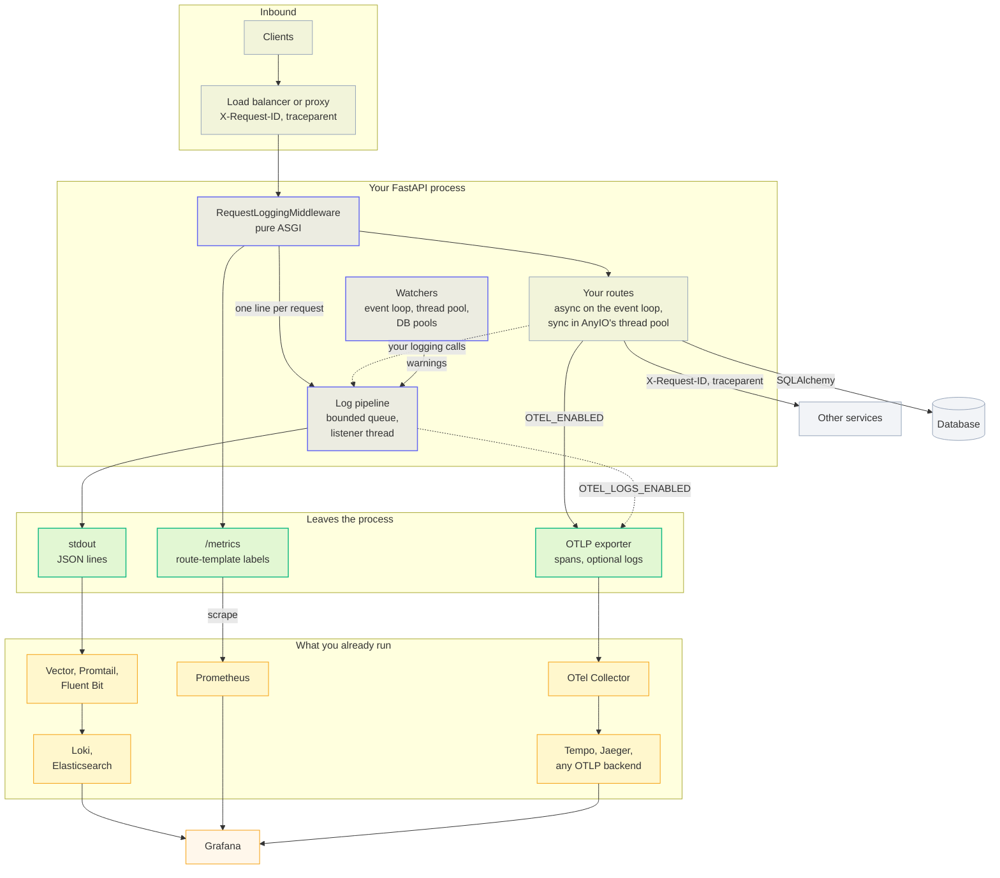
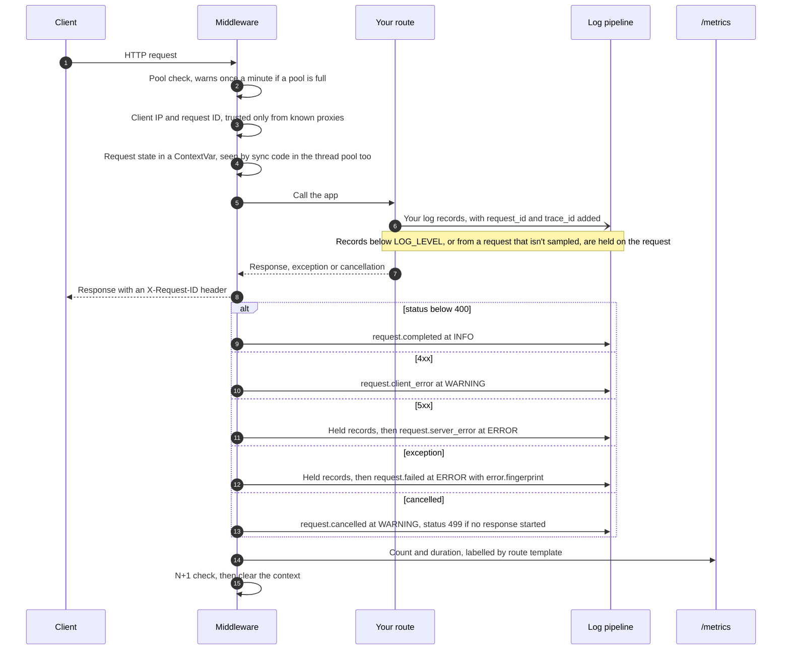
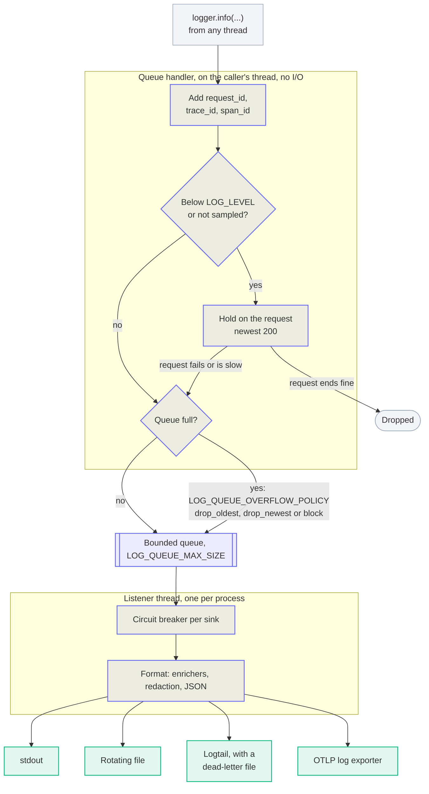
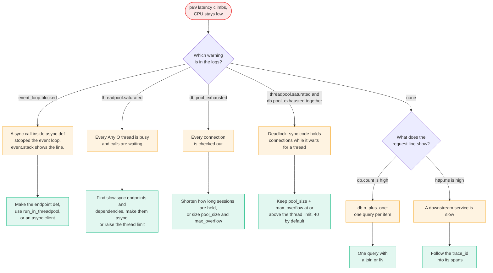

# Architecture

Why it's built this way, with the evidence and what each choice cost, is in the [design decisions](decisions/index.md).

## The system at a glance

Everything runs inside your FastAPI process. There is no agent and no vendor backend: data leaves as JSON lines on stdout, as a Prometheus `/metrics` page, and over OTLP.

Purple is fastapi-observer, green is where data leaves the process, and orange is what you run already. Optional parts are left out: the runtime control endpoint, the Logtail sink and the tamper-evident audit log.

## What `install_observability()` Wires Up

1. Profile-aware config bootstrap (`OBS_PROFILE`) and env-driven defaults for settings/policies.
2. Structured logging pipeline (JSON formatter + bounded async queue handler).
3. Metrics backend and `/metrics` endpoint when metrics are enabled.
4. OTel tracing setup when OTel is enabled.
5. Optional OTel logs/metrics setup when OTLP settings are enabled.
6. Request logging middleware with sanitization and context cleanup.
7. Runtime control endpoint when runtime control is enabled.
8. Lifespan-based teardown hooks for logging and SQLAlchemy instrumentation cleanup.

## One request

- The request ID comes from `X-Request-ID` only when the peer is a trusted proxy. Otherwise it's a new UUID. Outbound calls from clients OpenTelemetry instruments, such as `httpx` and `requests`, forward it along with `traceparent`.
- A request that takes `LOG_SLOW_REQUEST_MS` or longer has its sampled-out records written too, and so does every request that fails.
- The request line is redacted before it's written. With tracing on, it also counts the request's database queries and outbound HTTP calls (`db` and `http`, each with `count` and `ms`).
- 404s for paths no route matches share one `<unmatched>` metrics label, so scanners can't add a time series per URL.

## The log pipeline

- **Holding is off by default.** It's on only with `LOG_LEVEL_ON_ERROR` set, or `LOG_SAMPLE_RATE` below 1. `WARNING` and higher are never held.
- **Your code never waits on I/O.** The calling thread only adds context and puts the record on the queue. Formatting, redaction and writing happen on the listener thread, so a slow stdout or a down log service can't stall the event loop.
- **Overload is counted, not hidden.** `/metrics` shows the queue's size, enqueued, dropped and blocked records, each sink's circuit-breaker state, and log bytes per route.
- **After a fork**, as in gunicorn with `--preload`, the child process gets a new queue, new locks and a new listener thread. It doesn't touch anything the parent's threads could have been holding.
- **On shutdown**, the lifespan, or `atexit` without one, stops the listener after it writes what's left in the queue.

## Diagnosing "slow, but CPU is low"

This is the question asked most in FastAPI's GitHub Discussions about production. Requests are waiting, not working, and each place they can wait has its own warning.

- `event_loop.blocked` needs `OBS_LOOP_BLOCK_THRESHOLD_MS`. The pool warnings are always on. The `db` and `http` counts need tracing.
- When clients or the load balancer give up before you answer, the same slowdown also shows as a rise in `request.cancelled` lines.

### Route Exclusion Auto-Discovery

At application lifespan start, observability scans registered routes and auto-discovers paths that should be excluded from telemetry noise:

- FastAPI utility routes such as `/docs`, `/redoc`, `/openapi.json`
- Routes marked `include_in_schema=False`

Discovered paths are normalized (including dynamic path variants like `/:id`) and used for metrics exclusion, with active OTel middleware exclusions updated when present.

### Internal Package Layout (Contributor Map)

The project is now organized as focused subpackages instead of large monolithic modules:

- `fastapiobserver/logging/`: formatter, queueing, filters, setup lifecycle, sink circuit-breakers.
- `fastapiobserver/middleware/`: request logging orchestration, context, IP resolution, headers, body capture, metrics hooks.
- `fastapiobserver/sinks/`: sink protocol, registry/discovery, built-ins, factory wiring, Logtail + DLQ implementation.
- `fastapiobserver/metrics/`: backend contract and registry; `prometheus.py` holds the Prometheus backend, the `/metrics` endpoint (rendered by `prometheus_client`) and multiprocess helpers.
- `fastapiobserver/security/`: policy/settings models, normalization helpers, redaction engine, trusted-proxy utilities.
- `fastapiobserver/otel/`: OTel settings/resource/tracing/logs/metrics/lifecycle helpers.

Public imports remain backward-compatible via package facades (`__init__.py` re-exports).

---
