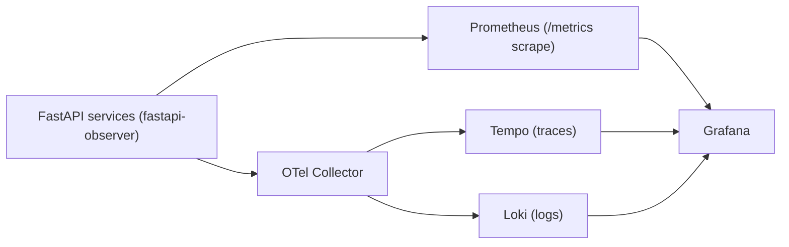

# Production Deployment Guide

This section is deployment-first. A new engineer should be able to ship this stack without reading the source code.

### Reference architecture



### Minimal collector config

```yaml
receivers:
  otlp:
    protocols:
      grpc:
        endpoint: 0.0.0.0:4317
      http:
        endpoint: 0.0.0.0:4318

processors:
  memory_limiter:
    limit_mib: 512
    spike_limit_mib: 128
    check_interval: 5s
  batch:
    send_batch_size: 512
    timeout: 5s

exporters:
  otlphttp/tempo:
    endpoint: http://tempo:4318
  otlphttp/loki:
    endpoint: http://loki:3100/otlp

service:
  pipelines:
    traces:
      receivers: [otlp]
      processors: [memory_limiter, batch]
      exporters: [otlphttp/tempo]
    logs:
      receivers: [otlp]
      processors: [memory_limiter, batch]
      exporters: [otlphttp/loki]
```

### Rollout strategy

1. Baseline current service SLOs before migration (`latency`, `error rate`, `availability`).
2. Enable `fastapi-observer` in one service with conservative settings (no body capture).
3. Run canary rollout (5-10% traffic) and compare:
   latency p95, 5xx rate, and log/traces pipeline health.
4. Expand rollout to all replicas/services after 24-48h stable canary.
5. Enable advanced controls in phases:
   security presets, allowlists, runtime control plane, OTLP logs mode.

### Failure modes and expected behavior

| Failure mode | Expected behavior | Immediate action |
|---|---|---|
| OTel Collector down | App still serves traffic; local logs still available if `OBS_OTEL_LOGS_MODE=both` | Fail over Collector or temporarily switch to local-json mode |
| Tempo down | Traces unavailable; logs/metrics continue | Restore Tempo, keep incident correlation via logs |
| Loki down | Logs unavailable in Grafana; metrics/traces continue | Restore Loki, use app stdout logs temporarily |
| Prometheus down | No metrics/alerts; app traffic unaffected | Restore Prometheus and alertmanager path |
| High cardinality on paths | Prometheus pressure increases | Use route templates and exclude noisy paths |
| Spoofed forwarded headers | Incorrect client IP/request ID trust | Tighten `OBS_TRUSTED_CIDRS` and proxy chain config |

### SLO and alert checklist

Recommended SLOs:
- Availability: `>= 99.9%` over 30 days
- p95 latency: `< 500ms` for core APIs
- 5xx rate: `< 1%` per service
- Error-budget burn alerting: fast burn (1h), slow burn (6h)

Starter alert queries:

```promql
# 5xx fraction per service (5 minutes); add a minimum-traffic guard for alerts.
sum(rate(http_requests_total{status_code=~"5.."}[5m])) by (service)
/
sum(rate(http_requests_total[5m])) by (service)

# p95 latency per service
histogram_quantile(
  0.95,
  sum(rate(http_request_duration_seconds_bucket[5m])) by (le, service)
)

# Traffic drop detection
sum(rate(http_requests_total[5m])) by (service)
```

### Incident playbook (first 15 minutes)

1. Confirm blast radius in Grafana:
   affected services, status codes, latency shifts, deployment changes.
2. Increase signal quality without restart:
   use runtime control plane to raise log level and tracing sample ratio.
3. Identify dependency failures:
   check Collector, Loki, Tempo, Prometheus health and ingestion queues.
4. Mitigate:
   roll back latest app change, scale affected service, or disable expensive capture options.
5. Verify recovery:
   p95 + 5xx return to baseline, trace volume normalized, alert clears.

### Kubernetes

The bundled manifests in `examples/k8s` deploy this whole stack with one command. See the [Kubernetes guide](kubernetes.md).

## Release validation budgets

PRs and releases call the same validation workflow. A release must identify one
immutable tagged commit and publish the stored, hash-checked distributions that
passed its gates. The backend jobs install that wheel into the Compose apps and
run the existing verifier with tracing enabled and disabled.

The automated workload budgets are deliberately explicit:

| Scenario | Gate |
|---|---|
| SIGTERM with eight concurrent requests | Ordinary responses, streams and background work finish within four seconds with one terminal JSON record per request and no local request-log loss; Uvicorn's request grace is one second |
| Request exceeding that grace | Cancellation is recorded, without inventing a client-disconnect cause |
| Collector unavailable | Ten requests finish within two seconds; process shutdown within four seconds with a 0.2-second OTLP transport timeout; all ten local terminal records survive in `both` mode |
| Blocked sink | A 50 ms drain/stop wait returns within 500 ms; 100 loopback requests retain p95 below 100 ms while queue drops are counted; active outputs remain open for retry |
| Warm worker | After 300 warm-up and 1,000 further distinct-query requests, retained Python heap grows less than 8 MiB, Linux RSS less than 32 MiB, and thread count by at most two |
| Worker replacement | Twelve sequential workers retain one bounded route series and accurate cumulative request/histogram counts |

The stress report is retained as a workflow artifact. CPU version comparisons
are available as [manual profiling commands](benchmarks.md#manual-version-comparison);
shared-runner timing variance does not block releases. These are reproducible
workload checks, not a promise of arbitrary
production capacity. Measure the same limits against your service's traffic,
payload sizes and failure budget. OTLP data may be lost throughout a Collector
outage; durable retry queues belong in the collection layer. Queue overflow is
also intentionally lossy and must be monitored.

Security presets apply to library-owned log output. Trace attributes and events
retain the application's/OpenTelemetry provider's privacy policy; validate URL,
query-string and exception handling before enabling export in a sensitive app.

---

