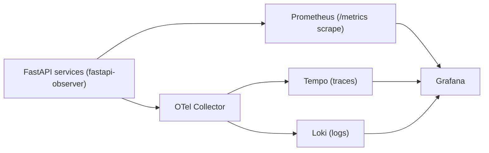

# Production Deployment Guide

## Reference architecture



The bundled manifests in `examples/k8s` deploy this stack with one command. See
the [Kubernetes guide](kubernetes.md).

## Minimal collector config

```yaml
receivers:
  otlp:
    protocols:
      grpc:
        endpoint: 0.0.0.0:4317
      http:
        endpoint: 0.0.0.0:4318

processors:
  memory_limiter:
    limit_mib: 512
    spike_limit_mib: 128
    check_interval: 5s
  batch:
    send_batch_size: 512
    timeout: 5s

exporters:
  otlphttp/tempo:
    endpoint: http://tempo:4318
  otlphttp/loki:
    endpoint: http://loki:3100/otlp

service:
  pipelines:
    traces:
      receivers: [otlp]
      processors: [memory_limiter, batch]
      exporters: [otlphttp/tempo]
    logs:
      receivers: [otlp]
      processors: [memory_limiter, batch]
      exporters: [otlphttp/loki]
```

## Failure modes

| Failure mode | Expected behavior | Immediate action |
|---|---|---|
| OTel Collector down | App still serves traffic; local logs still available if `OBS_OTEL_LOGS_MODE=both` | Fail over Collector or temporarily switch to local-json mode |
| Tempo down | Traces unavailable; logs/metrics continue | Restore Tempo, keep incident correlation via logs |
| Loki down | Logs unavailable in Grafana; metrics/traces continue | Restore Loki, use app stdout logs temporarily |
| Prometheus down | No metrics/alerts; app traffic unaffected | Restore Prometheus and alertmanager path |
| High cardinality on paths | Prometheus pressure increases | Use route templates and exclude noisy paths |
| Spoofed forwarded headers | Incorrect client IP/request ID trust | Tighten `OBS_TRUSTED_CIDRS` and proxy chain config |

OTLP data sent during a Collector outage is lost; put durable retry queues in
the Collector. A full log queue drops records too: alert on
`fastapiobserver_log_queue_dropped_total`.

Redaction presets cover the library's log output. Span attributes and events
follow the OpenTelemetry provider's policy, so check URLs, query strings and
exception messages in traces before exporting them from a sensitive app.

## Alert queries

```promql
# 5xx fraction per service (5 minutes); add a minimum-traffic guard for alerts.
sum(rate(http_requests_total{status_code=~"5.."}[5m])) by (service)
/
sum(rate(http_requests_total[5m])) by (service)

# p95 latency per service
histogram_quantile(
  0.95,
  sum(rate(http_request_duration_seconds_bucket[5m])) by (le, service)
)

# Traffic drop detection
sum(rate(http_requests_total[5m])) by (service)
```

During an incident, the [runtime control plane](runtime-control.md) raises the
log level or trace sampling ratio without a restart.
