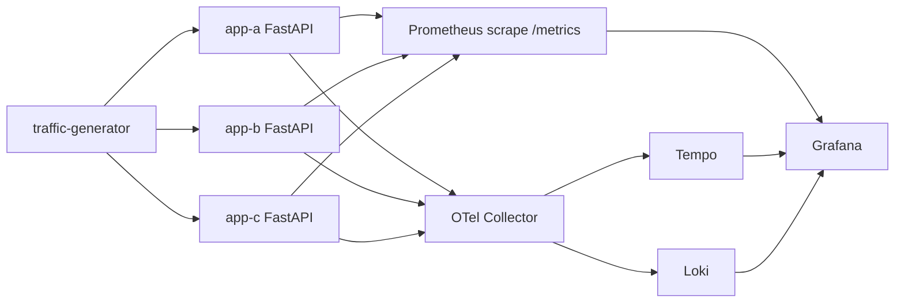

# Kubernetes Deployment Guide (FastAPI Observer)

`examples/k8s` deploys three FastAPI services, a traffic generator, an
OpenTelemetry Collector, Prometheus, Loki, Tempo and Grafana into the
`observability` namespace. Grafana shows metrics scraped from `/metrics` on
`app-a`, `app-b` and `app-c`, logs sent to Loki through the Collector, and
traces in Tempo, including cross-service `/chain` requests.

## Architecture



## Prerequisites

- Kubernetes cluster (`v1.26+` recommended)
- `kubectl` configured for your cluster
- Outbound internet access for pulling container images

## Deploy

```bash
kubectl kustomize --load-restrictor=LoadRestrictionsNone examples/k8s | kubectl apply -f -
```

`--load-restrictor=LoadRestrictionsNone` lets Kustomize read the dashboard JSON
from `examples/full_stack`, outside the `examples/k8s` folder.

Wait for all Deployments:

```bash
kubectl -n observability rollout status deployment/app-a
kubectl -n observability rollout status deployment/app-b
kubectl -n observability rollout status deployment/app-c
kubectl -n observability rollout status deployment/otel-collector
kubectl -n observability rollout status deployment/prometheus
kubectl -n observability rollout status deployment/loki
kubectl -n observability rollout status deployment/tempo
kubectl -n observability rollout status deployment/grafana
kubectl -n observability rollout status deployment/traffic-generator
```

## Access Grafana and Validate Signals

Port-forward Grafana:

```bash
kubectl -n observability port-forward svc/grafana 3000:3000
```

Open [http://localhost:3000](http://localhost:3000).

Expected dashboard behavior:
- Dashboard: `FastAPI Observer — API Overview`
- Variable `service`: switch between `app-a`, `app-b`, `app-c`
- Variable `environment`: switch to `k8s` (dashboard default in the shared JSON is `local`)
- Panels should populate within 1-2 minutes:
  - Request rate by path
  - P95 latency
  - 5xx rate
  - API logs from Loki

Trace verification:
1. In Grafana, open **Explore -> Tempo**.
2. Query `service.name = app-a`.
3. Pick traces containing `/chain` spans to verify cross-service propagation.

## Optional: Port-forward Other Components

```bash
kubectl -n observability port-forward svc/prometheus 9090:9090
kubectl -n observability port-forward svc/loki 3100:3100
kubectl -n observability port-forward svc/tempo 3200:3200
```

## Production differences

The app Pods run `pip install` at startup, and Loki, Tempo and Prometheus have no
persistent volumes. Grafana allows anonymous access, and the Collector sends to
Tempo and Loki over plain HTTP. Build your own image, add storage and turn on
authentication and TLS before running this outside a demo.

## Cleanup

```bash
kubectl kustomize --load-restrictor=LoadRestrictionsNone examples/k8s | kubectl delete -f -
```
